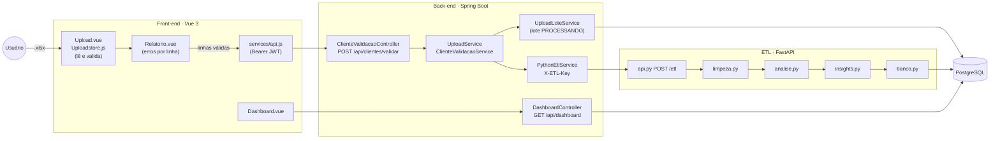

# Blinsights

Aplicação web para validação e análise de planilhas comerciais de clientes, desenvolvida como Projeto Integrador (Situação de Aprendizagem **Provedor CTI**). O usuário envia a planilha `.xlsx`, vê os erros por linha antes do envio e acompanha os indicadores da carteira em um dashboard. Somente dados válidos chegam ao banco.

## Funcionalidades

**Conta e acesso**

- `RF-001` **Cadastrar usuário:** nome, e-mail, senha, matrícula e turma. A conta nasce `PENDENTE`.
- `RF-002` **Entrar:** login com e-mail e senha, que devolve um token JWT válido por 12 horas. Só contas `APROVADO` entram.
- `RF-003` **Sair:** encerra a sessão. Um token expirado também desloga o usuário automaticamente.

**Administração** (perfil `ADMIN`)

- `RF-004` **Listar usuários**, com filtro por status (`PENDENTE`, `APROVADO`, `BLOQUEADO`).
- `RF-005` **Aprovar ou bloquear** uma conta.
- `RF-006` **Administrador inicial** criado automaticamente na primeira inicialização (`ADMIN_EMAIL` / `ADMIN_PASSWORD`).

**Planilha**

- `RF-007` **Importar planilha** `.xlsx` por clique ou arrastar e soltar.
- `RF-008` **Validar no navegador:** relatório de erros por linha e coluna antes do envio.
- `RF-009` **Enviar só as linhas válidas.** O backend valida tudo de novo (Bean Validation e códigos duplicados).
- `RF-010` **Processar (ETL):** padroniza os dados, calcula as estatísticas e grava clientes, contratos e o resultado do lote.

**Dashboard**

- `RF-011` **Indicadores:** clientes analisados, faturamento total, médio e mediana.
- `RF-012` **Gráficos:** clientes por segmento, nível e consultor, serviços contratados e contratações por mês.
- `RF-013` **Insights** gerados automaticamente a partir dos indicadores.
- `RF-014` **Histórico:** escolher um lote (planilha) já processado.

## Tecnologias

| Camada | Tecnologias |
|---|---|
| Front-end | Vue 3, Vite, Pinia, Vue Router, Axios, Tailwind CSS, Chart.js, SheetJS |
| Back-end | Java 17+, Spring Boot 4, Spring Security (OAuth2 Resource Server / JWT HS256), Spring Data JPA, JdbcTemplate |
| Ciência de dados | Python, FastAPI, pandas, NumPy, SciPy, SQLAlchemy |
| Banco | PostgreSQL (Neon ou Azure) |
| Hospedagem | Vercel (front) e Render (API em Docker e ETL em Python). Veja [SYNAPSE/docs/DEPLOY.md](SYNAPSE/docs/DEPLOY.md) |

## Arquitetura e fluxo de dados



1. O Vue lê a planilha, identifica as linhas com erro e envia somente as válidas.
2. O Spring valida os DTOs, cria um lote `PROCESSANDO` e encaminha os dados ao FastAPI com a chave `X-ETL-Key`.
3. O FastAPI/pandas normaliza os dados, calcula as estatísticas e grava clientes, contratos e o JSON do dashboard.
4. O Spring consulta lotes e estatísticas em `/api/dashboard` e `/api/dashboard/lotes`.
5. O Vue mostra os dados em `/sidebar/dashboard` (também aceita `/dashboard`).

## API (Spring)

| Método | Rota | Acesso | Descrição |
|---|---|---|---|
| GET | `/api/health` | público | verifica se a API está no ar |
| POST | `/api/auth/register` | público | cria conta (`PENDENTE`) |
| POST | `/api/auth/login` | público | devolve `{ id, nome, email, perfil, status, token }` |
| GET | `/api/auth/me` | autenticado | dados do usuário do token |
| POST | `/api/clientes/validar` | autenticado | recebe as linhas válidas e dispara o ETL |
| GET | `/api/dashboard?loteId=` | autenticado | estatísticas do lote (o mais recente, se omitido) |
| GET | `/api/dashboard/lotes` | autenticado | histórico de lotes |
| GET | `/api/admin/usuarios?status=` | ADMIN | lista usuários |
| GET | `/api/admin/usuarios/{id}` | ADMIN | detalhe de um usuário |
| PATCH | `/api/admin/usuarios/{id}/status?status=` | ADMIN | aprova ou bloqueia |
| DELETE | `/api/admin/usuarios/{id}` | ADMIN | remove usuário |

Erros de autenticação voltam em JSON: `401 {"erro": "Faça login para continuar."}` e `403 {"erro": "Você não tem permissão para isso."}`.

O serviço Python expõe `/saude`, `/testar` (calcula sem gravar), `/etl` (exige `X-ETL-Key`) e `/docs` (Swagger).

## Banco de dados

O backend executa [schema.sql](SYNAPSE/BackEnd/src/main/resources/schema.sql) a cada inicialização. Ele é idempotente (`IF NOT EXISTS`) e também atualiza bancos criados por versões antigas. O Hibernate não cria tabelas (`ddl-auto=none`). O Python garante as mesmas tabelas ao iniciar o ETL. Neon e Azure usam o mesmo schema.

Tabelas: `usuario`, `upload_lote`, `cliente`, `contrato`, `estatistica_lote`.

## Configuração local

Pré-requisitos: Java 17+, Node 20+, Python 3.11+ e um PostgreSQL (local, Neon ou Azure).

1. Copie `SYNAPSE/BackEnd/.env.example` para `SYNAPSE/BackEnd/.env` e preencha as credenciais do PostgreSQL.
2. Copie `SYNAPSE/CienciaD/analytics-python/.env.example` para `.env` na mesma pasta, usando o mesmo banco. Para um PostgreSQL local sem SSL, use `DB_SSLMODE=disable`.
3. Coloque o mesmo valor forte de `ETL_API_KEY` nos dois `.env`.
4. Configure `JWT_SECRET` no backend com pelo menos 32 caracteres aleatórios. Sem isso a API não inicia.
5. Opcional: `ADMIN_EMAIL` e `ADMIN_PASSWORD`. Os padrões são `admin@blinsights.local` / `Admin@12345`; **troque em produção**.
6. Opcional: `ETL_URL` (padrão `http://localhost:8000`) e, no front, `VITE_API_URL` (padrão `http://localhost:8080/api`; veja `SYNAPSE/FrontEnd/.env.example`).
7. Os arquivos `.env` não devem ser versionados.

## Executar no Windows

Em três terminais, a partir da pasta `SYNAPSE`:

```powershell
cd CienciaD\analytics-python
python -m venv .venv
.\.venv\Scripts\Activate.ps1
pip install -r requirements.txt
uvicorn api:app --port 8000
```

```powershell
cd BackEnd
.\mvnw.cmd spring-boot:run
```

```powershell
cd FrontEnd
npm install
npm run dev
```

Abra http://localhost:5173, entre com o administrador, envie a planilha e acesse **Dashboard**.

## Testes

```powershell
cd SYNAPSE\CienciaD\analytics-python
.\.venv\Scripts\python.exe -m unittest discover -s tests -v

cd ..\..\BackEnd
.\mvnw.cmd test

cd ..\FrontEnd
npm run build
```

- **Backend:** testes de integração com H2 em memória (health público, 401/403 em JSON, login do admin, `/auth/me`, acesso restrito ao admin, dashboard) e testes unitários do `UsuarioService`.
- **Python:** pipeline de limpeza, análise e gravação.

## Deploy

O passo a passo completo para Neon, Render e Vercel está em [SYNAPSE/docs/DEPLOY.md](SYNAPSE/docs/DEPLOY.md). O `render.yaml` na raiz cria a API e o ETL de uma vez.

## Estrutura

```
Blinsights/
├── render.yaml                  # blueprint do Render (API + ETL)
└── SYNAPSE/
    ├── BackEnd/                 # Spring Boot (Dockerfile incluso)
    ├── CienciaD/analytics-python/  # FastAPI + pandas (ETL)
    ├── FrontEnd/                # Vue 3 + Vite (vercel.json incluso)
    └── docs/DEPLOY.md
```
